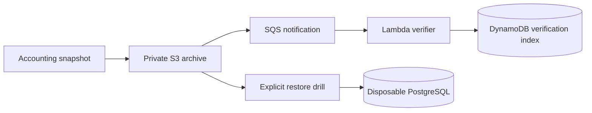

# Trezia

A multi-society accounting application for maintenance bills, receipts, dues,
expenses, resident access, imports and recoverable financial records.

## Architecture

Next.js and TypeScript provide the application. Supabase supplies PostgreSQL,
authentication and row-level security. Private object storage holds documents
and snapshots. Server routes enforce society membership and financial roles;
resident views expose account-scoped information. Demo views use
synthetic fixtures and do not call operational data services.

## Local setup

Use Node.js 22+ and npm. Copy `.env.example` to `.env.local` and configure a
disposable Supabase project and your own optional storage/integration services.
The default site URL is localhost.

```sh
npm ci
npm run dev
```

For local database work, install Docker and the Supabase CLI. `npm run db:start`
starts the local stack. `npm run test:rls:local` and `npm run restore:drill` use a
disposable localhost database and require Docker. A restore drill deliberately
wipes that disposable database. Never provide a hosted database URL to it.

## Verification

`npm run ci:check` runs TypeScript, lint, dependency audit and Jest coverage.
`npm run ci:full` adds the production build and strict secret scan, which requires
Gitleaks. `npm run release:gate` also checks production assets, browser behavior,
live database authorization and snapshot restore.

## AWS recovery extension

`infra/` contains portable CloudFormation templates and their generator.
`aws_lab/` contains S3/SQS/Lambda/DynamoDB archive validation, synthetic workloads,
unit tests and destructive local-database recovery drills on AWS CodeBuild.
Account identity and resource outputs are supplied at runtime.



```sh
python infra/generate.py
python -m unittest discover -s aws_lab/tests -v
python -m unittest discover -s infra -p 'test_*.py' -v
```

## Measured cloud recovery

| Experiment | Baseline | Optimized / verified result |
| --- | --- | --- |
| 1,000 receipts/archive, pooled completion P99 | 26.35 s | **5.83 s; 77.9% lower** |
| Same workload, pooled completion P95 | 23.56 s | **5.46 s; 76.8% lower** |
| Completed archives / sum of campaign durations | 4.69/s | **16.80/s** |
| Destructive database recovery | Wipe, restore and verify | **52.30 / 51.87 / 52.26 s**, three drills |

The performance change combined Lambda memory **128 → 512 MiB** with SQS batch
size **1 → 5**. Both configurations used the same synthetic workload, eight
uploader threads and maximum Lambda concurrency two. Three 100-archive
repetitions per configuration/fixture size processed **1,200 archives** in total.
Each repetition uploads a batch of 100 archives. Completion is measured from
before S3 upload to the first strongly consistent DynamoDB COMPLETED observation,
including queueing and polling.

Each destructive recovery restored 55 units, 1,004 receipts and 1,044 audit rows
across 33 table arrays, checked counts/content hashes, then accepted an audited
write. The under-53-second interval starts at the disaster wipe and ends after
verification. Whole rehearsals, including fixture capture, took 106.54–114.09 s.
The drills ran on a nominal four-vCPU/eight-GiB CodeBuild worker.

[Reference results](aws_lab/reference_results.json),
[1,200 numeric archive observations](aws_lab/evidence/archive_samples.json) and
[restore timestamps/counts](aws_lab/evidence/restore_observations.json) are
available without tenant records or account identifiers. Recompute them locally:

```sh
python aws_lab/verify_results.py
```

## Financial integrity

PostgreSQL triggers reject hard deletes of financial records; audit entries and
society-scoped policies preserve traceability. Start with
[`004_triggers.sql`](supabase/migrations/004_triggers.sql), the subsequent policy
migrations, and the synthetic authorization/restore tests under `__tests__/`.
The application serves **55 flats tracking ₹9.86 lakh in dues**.

## Layout and policy

`src/` holds application code; `supabase/migrations/` holds schema/policies;
`__tests__/` holds automated checks; `scripts/` holds local operations; `public/`
holds static assets.
See `SECURITY.md`, `CONTRIBUTING.md` and `NOTICE`.
